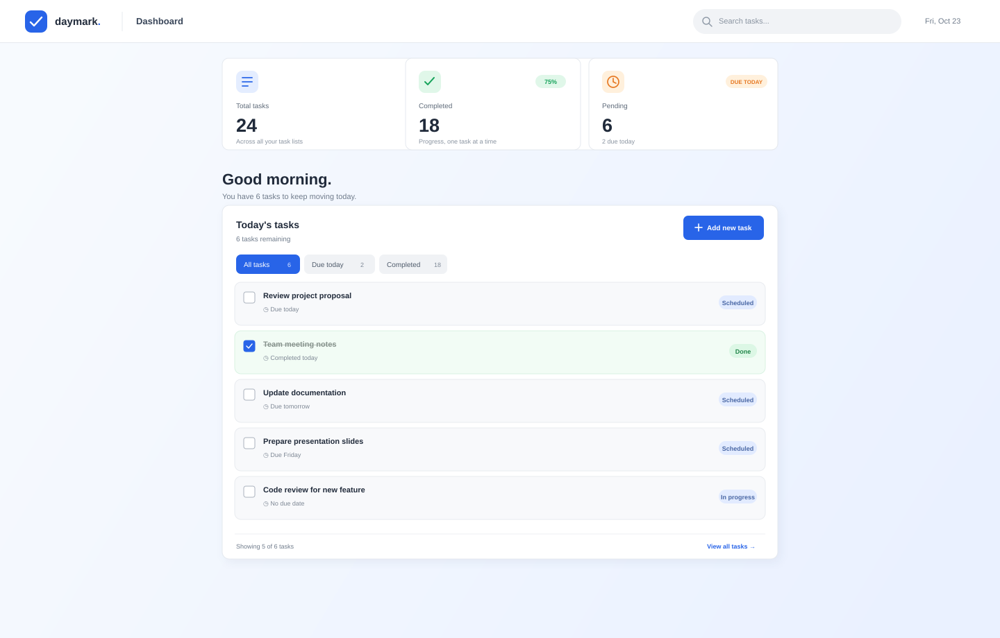

# daymark. | Make room for what matters

**Live demo:** [Add the deployed frontend URL here](#deployment) · **API:** [Add the Render backend URL here](#deployment)

Daymark is a calm, practical task manager for keeping deadlines and everyday to-dos in one place. It was built to make the next useful action easier to see, without turning a to-do list into another noisy dashboard.



## What It Does

- Create tasks with a title, details, and optional due date.
- Edit, complete, and remove tasks.
- Keep deadline tasks, flexible tasks, and completed work in separate groups.
- See completion progress at a glance.
- Get a clear wake-up message and retry option while the hosted Render API starts. The first request can take up to a minute on an idle service.

## Tech Stack

- **Frontend:** JavaScript, React 19, Create React App, CSS
- **Backend:** Node.js, Express 4
- **Database:** MongoDB with Mongoose
- **HTTP:** Fetch API
- **Hosting:** Render-compatible frontend and API configuration

## Run Locally

### Prerequisites

- Node.js 18 or later and npm
- A MongoDB connection string (local MongoDB or MongoDB Atlas)

### 1. Clone the repository

```bash
git clone https://github.com/SivaranjaniSahadevan07/Todo_App.git
cd Todo_App
```

### 2. Configure the backend

```bash
cd backend
npm install
```

Create `backend/.env`:

```env
DB_URI=mongodb://127.0.0.1:27017/daymark
PORT=5000
HOST=localhost
FRONTEND_URL=http://localhost:3000
```

Set `DB_URI` to your own MongoDB connection string. Start the API:

```bash
npm start
```

### 3. Configure and start the frontend

In a second terminal, from the repository root:

```bash
cd frontend
npm install
npm start
```

Open [http://localhost:3000](http://localhost:3000). The frontend defaults to `http://localhost:5000` for its API. To use a different API address, create `frontend/.env` before starting the frontend:

```env
REACT_APP_API_URL=http://localhost:5000
```

## Deployment

Deploy the backend as a Render web service using `backend` as its root directory and `npm start` as its start command. Configure `DB_URI` with your MongoDB connection string and `FRONTEND_URL` with the deployed frontend origin.

Deploy `frontend` as a static site. Set `REACT_APP_API_URL` to the Render backend URL before building, and publish the generated `build` directory. Add the deployed frontend and API URLs to the links at the top of this README once they are available; no working deployment URL is configured in this repository yet.

Render may suspend an idle backend. The first API request after suspension can take up to a minute; Daymark keeps the loading state visible and provides a retry button if the request fails.